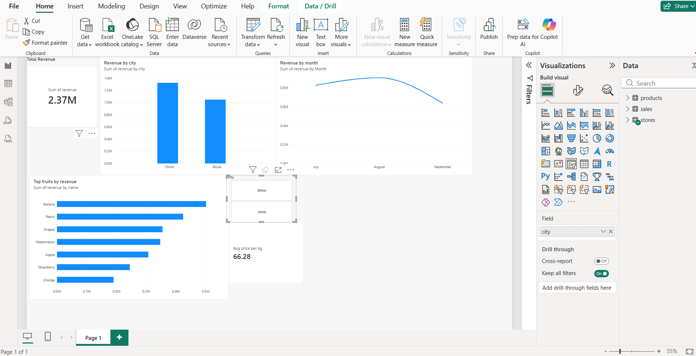

# Fruit Shop Sales Analysis 🍎

A practice data analysis project: sales of 7 fruits in two shops (**Bitola** and **Ohrid**, North Macedonia) from **July to September 2026**.

The same questions are answered with three tools: **SQL**, **Power BI** and **Excel**. The numbers match across all three.

> The data is fictional. It was generated with a Python script (`create_fruit_db.py`) to include realistic patterns: seasonality, weekends and summer tourism in Ohrid.

## Data

| Table | Rows | Columns |
|---|---|---|
| `products` | 7 | product_id, name, price_per_kg (MKD) |
| `stores` | 2 | store_id, city |
| `sales` | 1,288 | sale_id, sale_date, product_id, store_id, quantity_kg, revenue |

The model is a **star schema**: `sales` is the fact table, `products` and `stores` are dimension tables.

## What I did

| Tool | Work |
|---|---|
| **SQL** (SQLite + Python) | `JOIN`s across 3 tables, `GROUP BY` / `HAVING`, date functions (`strftime`), CTEs, window functions (`ROW_NUMBER() OVER (PARTITION BY ...)`) for "top N per group" questions |
| **Power BI** | Data model with relationships, KPI cards, line / column / bar charts, slicer, cross-filtering, DAX measure (`DIVIDE`) | , DAX measures with CALCULATE, ALL, DIVIDE, date table and month-over-month growth (PREVIOUSMONTH)
| **Excel** | `XLOOKUP`, `IF`, `COUNTIF`, `SUMIFS`, `TEXT` for dates, PivotTable and PivotChart |

## Key findings

- **Total revenue:** 2,373,766 MKD over 3 months.
- **Ohrid earned about 26% more than Bitola** (1.32M vs 1.05M MKD), but only in summer. In September Ohrid fell below Bitola, which points to tourist demand.
- **Watermelon sold the most by weight** (about 13,900 kg) but was only 4th by revenue, because it is the cheapest fruit (25 MKD/kg). **Banana brought the most money** (502,074 MKD).
- **The best-selling fruit changed every month:** Banana in July, Peach in August, Grapes in September.
- **Average price per kg is about 66 MKD**, not 97 MKD (the simple average of the price list). Cheap watermelon is sold in large volumes and pulls the real average down. This is why I calculate it as total revenue / total kg.

## Recommendation

From September, the shops should order **fewer watermelons and peaches** and **more grapes and apples**, especially in Ohrid, where summer demand drops the most.

## Files

| File | Description |
|---|---|
| `fruit_shop.db` | SQLite database |
| `create_fruit_db.py` | Script that generates the data |
| `practice.py` | SQL exercises (JOIN, GROUP BY, HAVING, dates) |
| `windows_functions.py` | SQL window function exercises (CTE + ROW_NUMBER) |
| `fruit_shop.xlsx` | Data source for Power BI |
| `fruit_shop_excel.xlsx` | Excel workbook with formulas, PivotTable and PivotChart |
| `fruit_shop_dashboard.pbix` | Power BI dashboard |
| `analysis.ipynb` | pandas analysis: merge, groupby, pivot_table, dates, charts |

## Tools

Python · SQLite · SQL · Power BI · DAX · Excel · Pandas · Matplotlib
